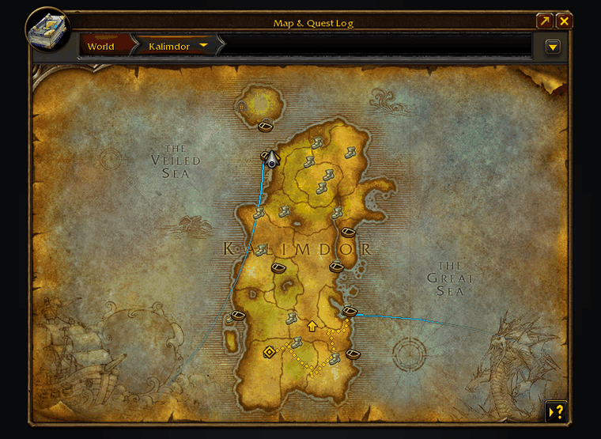
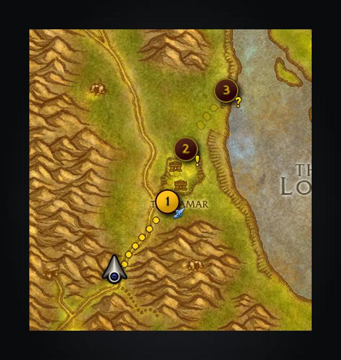
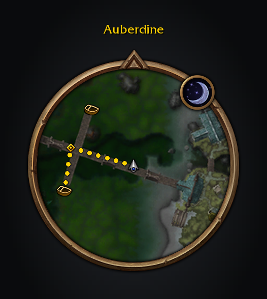
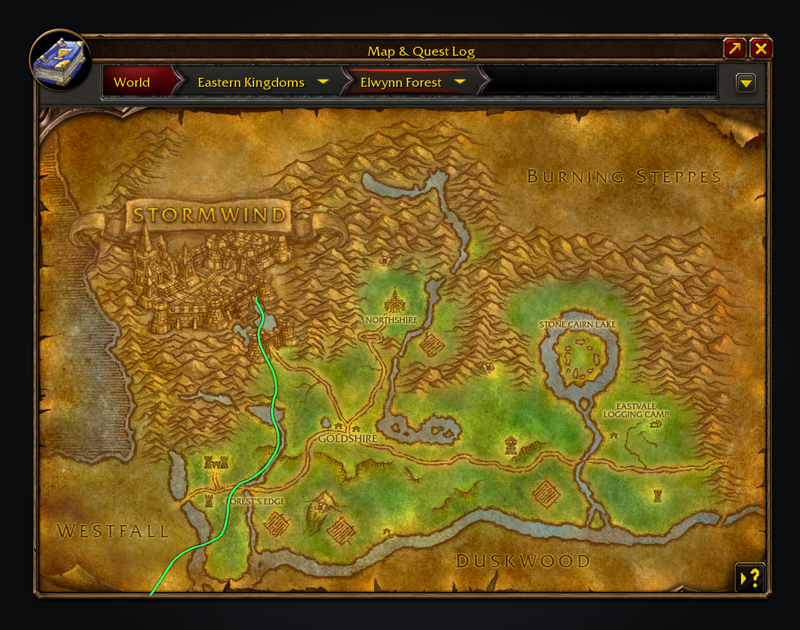
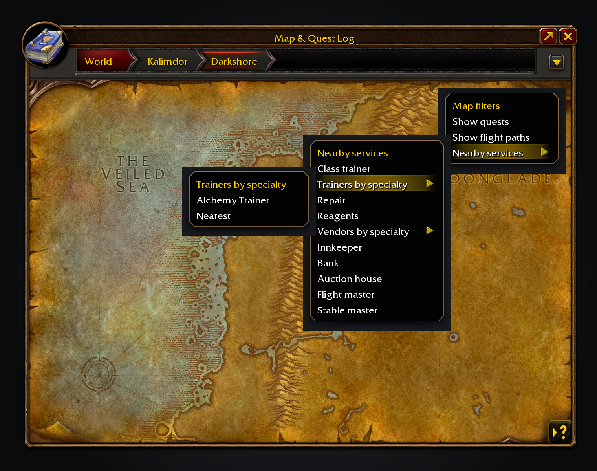
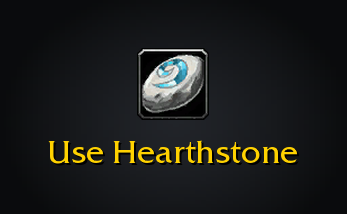
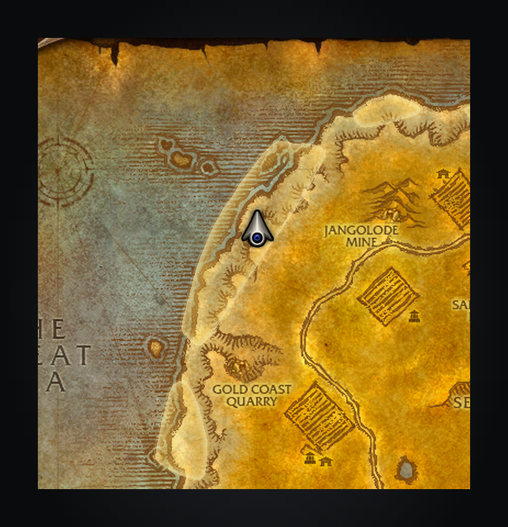
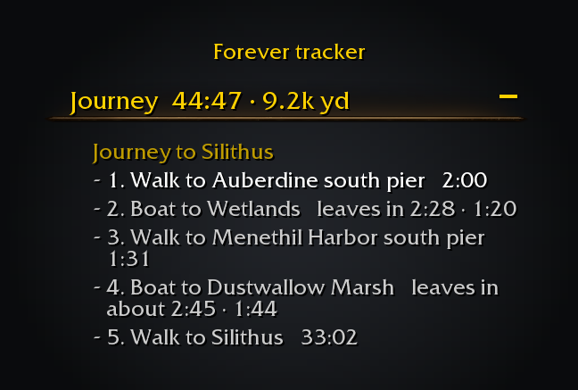

<h1 align="center">Shortest Path Forever</h1>

Plan journeys in WoW: Forever, on foot, by air, by sea and through portals. 

Shift-click the world map or minimap, or choose a quest, to plan a journey. Shortest Path Forever gives directions in the objective tracker and on both maps.

Planning a journey from the map: the route settles, the next boat counts down in the tracker and the compass turns
with you.

## Features

- **Plan a journey.** Shift-click the world map or minimap, or choose *Plan journey* on a quest. Routes combine walking, flights, boats, zeppelins, lifts, the tram, portals and teleports, and replan as you move. A spot inside a dungeon or raid leads to its entrance. *Keep journeys after a reload* in Guidance restarts your own journey after a `/reload`.
  
  The tracker shows each step, with time and distance remaining. Hover the destination's pin on the world map for the same steps, and, with the other faction's routes hidden, whether their boats would be at least two minutes faster.
- **Follow your guide.** Journeys follow RestedXP's current target by default, without TomTom or a bridge addon; *Resume guide* returns to it after another journey, unless Adventure Guide's RestedXP display leads instead. With TomTom absent, other guides' TomTom waypoints start journeys here.
- **Type a waypoint.** `/way [zone] x y [title]` plans a journey there, written as for TomTom, while TomTom and other addons leave `/way` free; `/path way` always works. With TomTom installed, *Follow TomTom's arrow* in Guidance follows its arrow.
  
  The current stop lights up like a tracked quest.
- **Choose your guidance.** Keep the route on both maps while hiding the Journey tracker or direction arrow. The arrow eases round to each new bearing; move and scale it in Interface. Click the current step to complete it manually; skipping a Hearthstone leaves it out for that journey.
  
  Breadcrumbs show the walking route; the waypoint leads to the next step. A goal off the minimap waits on its rim.
- **See flights and departures.** Flight maps highlight your next flight, and a flight master's world map tooltip lists its flights and their times. Dock tooltips show destinations and departure times; nearby services count down in the tracker. Ride times improve estimates and are shared with other players.
  
  Flight lines follow the route between flight points.
- **Find nearby services.** The map and minimap tracking menus offer trainers, repairs, reagents, vendors, inns, banks, auction houses, flight masters and stables. Requires installed QuestieDB; class trainers also use Tweaks Forever.
  
  Choose a service to plan the trip there.
- **Travel prompts and alerts.** Hearthstone and teleport steps show the item or spell to use. A banner, transport sound and taskbar flash warn before your boat arrives. *Play a sound when you reach the goal* in Alerts plays the map's ping on arrival.
  
  The prompt clears as the journey continues.
- **Compass and corpse routes.** The compass marks turns, stops and your destination, and can show the time left under it. As a ghost, a red route leads to your body; your journey resumes when you are alive.
  
  The strip can be moved and resized separately from the tracker. While moving it or the arrow, Shift-drag, or rest the pointer on it and use the arrow keys, to place it to the pixel.
- **Quest areas.** Inside a quest's area, the client draws it in gold instead of a stop pin and line.
  
  The highlighted area is the game's own quest boundary.

More detail: [features](docs/features.md) and [API](docs/api.md).

## Install

Install it from [CurseForge](https://www.curseforge.com/wow/addons/shortest-path-forever) or
[Wago Addons](https://addons.wago.io/addons/shortest-path-forever), or download the zip from
[Releases](https://github.com/cjber/shortest-path-forever/releases). To install the zip by hand, extract it into
`_classic_beta_/Interface/AddOns/` so you end up with `AddOns/ShortestPathForever/ShortestPathForever.toc`.

## Usage

Alt-click the world map to choose a destination over a Questie icon. Shift-click works on empty map space and Shortest Path icons. With the gamepad interface on, Shortest Path never opens the world map itself; it asks you to.

The settings have five pages. **Transport** draws routes, shows the other faction's boats and zeppelins (off by default), and shares departure times. **Guidance** holds journey behaviour: *Resume guide*, *Keep journeys after a reload*, *Minimum Hearthstone saving* and *Attach to quest tracker*. **Map marks** scales each kind of icon from 25% to 200%. **Interface** shows or hides the tracker, arrow and compass, sizes them, and switches to metres. **Alerts** covers the boat warning and the arrival sound. [docs/features.md](docs/features.md) has the detail.

Right-click a flight master icon to mark its flight path as known if a flight map missed it. Open a flight master's map once after installing to sync the flight points you know.

| Command | What it does |
|---|---|
| `/path` | Open the settings (also in Settings → AddOns and the addon compartment) |
| `/path report` | Show a report to paste into a bug report: versions, your journey, your ride, recent errors |
| `/path perf` | Print this addon's CPU and memory use |
| `/path debug` | Keep a trace of your ride matching, for a ride that did not sync |
| `/spfnear` | Open nearby services; add a service such as `repair`, `trainer` or `flight` to route to the nearest one |

Every feature has its own switch in the settings; the world map's filter menu and the minimap's tracking menu hide
each kind of mark. Searches and tracker updates wait until combat ends.

It's in English for now; [Ways to help](#ways-to-help) says how to translate it.

## Move the tracker

Turn off **Attach to quest tracker** in Guidance, or right-click the tracker's "Journey to …" line and untick it there, then drag the shared Forever column by its heading. The column and its heading hide while nothing is tracked; turn the setting back on in Guidance to attach it above your quests again.

The heading moves the Forever sections; your quests keep their own position.

## Works alongside

Other addons can plan and guide journeys through `ShortestPathForever.API`, ask for travel times, and subscribe
to journey changes. [docs/api.md](docs/api.md) has the calls and what they return.

With *Follow RestedXP guides* on (the default), leave RestedXP's TomTom option off so only one addon follows the guide.

My other Forever addons send it their destinations when both are installed:

- [Adventure Guide Forever](https://www.curseforge.com/wow/addons/adventure-guide-forever): pick a quest journey or RestedXP step and Shortest Path leads you to each stop.
- [SkillUp Forever](https://www.curseforge.com/wow/addons/skillup-forever): click a trainer or vendor in a levelling route. SkillUp picks the nearest one by travel time.
- [Legacy Forever](https://www.curseforge.com/wow/addons/legacy-forever): click a dungeon or raid pin.
- [Tweaks Forever](https://www.curseforge.com/wow/addons/tweaks-forever): click a dungeon or raid entrance.

Journey steps share one tracker column with the Adventure Guide, SkillUp and Legacy sections, above your quests.

## Ways to help

No code needed:

- **A wrong route:** type `/path report` while the journey is on screen and paste it into a [Wrong route issue](https://github.com/cjber/shortest-path-forever/issues/new?template=wrong_route.yml).
- **An error:** open a [bug report](https://github.com/cjber/shortest-path-forever/issues/new?template=bug_report.yml) with the error's text, and paste `/path report` under its steps.
- **A translation:** translate [Locales/phrases.txt](Locales/phrases.txt) and paste it into a [translation issue](https://github.com/cjber/shortest-path-forever/issues/new?template=translation.yml).

## Development

Run `tools/typecheck.sh` for LuaLS and static checks, and `luajit tests/<name>_spec.lua` for a focused check. CI runs the full suite. [tests/README.md](tests/README.md) describes the test layers; [performance notes](tests/search_performance.md) and [type declarations](types/README.md) describe the rest. Releases follow [.agents/skills/release/SKILL.md](.agents/skills/release/SKILL.md).

[Contributing](https://github.com/cjber/.github/blob/main/CONTRIBUTING.md), [AGENTS.md](AGENTS.md) and [security reports](https://github.com/cjber/.github/blob/main/SECURITY.md).

## Licence

GPL-3.0-or-later. Routes, lifts, the tram and flight paths come from the game's data via
[wago.tools](https://wago.tools); transport timing and portals from [CMaNGOS](https://github.com/cmangos); recorded
flight times from [InFlight](https://github.com/LudiusMaximus/InFlight) (MIT). All inputs and their licences: [THIRD_PARTY.md](THIRD_PARTY.md).

Made by Cillian Berragan · [cillian.dev](https://cillian.dev) · [GitHub](https://github.com/cjber) · [Twitter](https://twitter.com/cjberragan)

Built with AI assistance.
