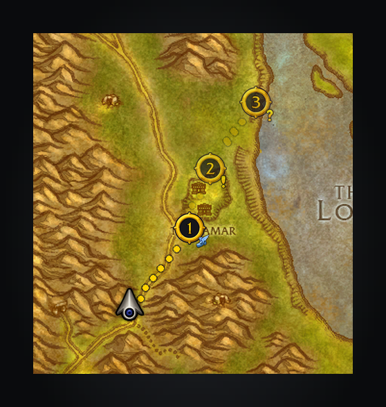

# Addon API

Addons can use `ShortestPathForever.API` (`version = 2`, `minor = 0`) with uiMapIDs and normalized 0-1 coordinates.
Version 2 removes peer sharing and `Leaderboard`; callers must accept versions 1 and 2 and reject future versions. Check that a function exists before calling it, because an older
addon may not have it yet. The full types are in [`types/API.lua`](../types/API.lua). On ForeverCore 1.3.2 or
later, the API is also listed by `ForeverCore.APIKit.Addons()`.

## Minor history

- Version 1, `minor = 3`: adds `Journey`, `Pause`, `Resume`, `SkipLeg`, `Stats` and the `leg` change in
  `Subscribe`.
- `minor = 2`: adds `RenameStop`, the stop fields `npc` and `handins`, and the `"vendor"` stop kind. They shipped
  while `minor` stayed 1, so they are listed together here.
- `minor = 1`: adds `Subscribe`.
- Before `minor` existed: `version = 1` published `Estimate`, `EstimateDetail`, `NavigateRoute`, `Navigate`,
  `CurrentStop`, `Cancel`, `Ended` and `Active`.

## Published members

- `Estimate(fromMap, fromX, fromY, toMap, toX, toY)` returns travel seconds, or `nil` and why (`"combat"`,
  `"loading"`, `"invalid"` or `"unreachable"`), without changing guidance. It omits endpoint terrain searches and caches
  estimates for five seconds, rounding origins to 0.0001. An estimate from where the player stands counts their
  hearthstone and class teleports, with cooldowns, unless the setting *Use hearth and teleports* is off.
  *Use Hearthstone* keeps only the Hearthstone out, and class teleports still count. From anywhere else it leaves
  them out.
- `EstimateDetail(fromMap, fromX, fromY, toMap, toX, toY)` takes the same arguments and cache and returns
  `{seconds, legs}`, each leg a fresh
  `{mode, to, seconds, wait?, newFlightPath?}`.
- `NavigateRoute(owner, stops)` guides through 1 to 64 `{map, x, y, title, tooltip, z}` stops in order, advancing on arrival
  and ending after the last. Remaining stops have numbered map pins, and the way between them is drawn as
  planned, walks along the walking map, once worked out behind the current leg; the tracker and arrow show
  “Stop 2 of 4: …”.
- `Navigate(owner, map, x, y, title, kind)` is the one-stop form.

  Both return a boolean; invalid input, combat or disabled Journeys return `false` without replacing guidance.
  A route whose only stop is the place the journey already goes to hands the journey over rather than starting it
  again: `CurrentStop` answers for the new owner, the previous owner's `Ended` reads `"replaced"`, and the stop, the
  progress, the arrow and the drawn route stay exactly as they are. A route with several stops is a different
  itinerary, and still replaces the journey.
  Titles are optional, as is `tooltip`, a destination detail shown on the stop pin's tooltip and under the arrival
  pin while the player stands in a held stop's area. It is never used as the arrow label; each newline in it starts a
  line of its own, and a line an earlier stop on the same pin already shows is not repeated. Optional `z` is the
  stop's world height in yards, any finite number: the pin snaps it to the nearest surface of its cell and compares
  that with the cell's ground layer, the floor nearest the terrain there. Above that floor it wears the map's up
  arrow and its tooltip says “Above ground level”; below it wears the down arrow and says “Below ground level”. On
  the ground, without a height, in a cell with no floors, over a cell whose ground has no terrain, or without a
  surface under it, no arrow is shown, and a pin marking several stops shows one only when all of them agree. A stop
  with `hold = true` waits for its
  owner to replace or cancel the route rather than advancing on arrival. For held objective areas,
  optional `radius` (yards, finite and non-negative) hides walking directions inside the area while preserving
  ownership and the current stop. Directions resume outside it. Optional `questID` names the quest a held area
  stands for, and optional `questIDs` every quest it stands for when there are several: an array of 1 or more quest
  IDs, given with or without `questID`.
  Optional `handins` names the quests handed in at the stop: an array of 1 or more quest IDs, copied like the rest.
  The game's own pin for each of those quests is hidden while the stop is drawn; `handins` never decides arrival or
  the stop's area, which stay with `questID`, `questIDs` and `shapes`. Optional `npc` names the service NPC the stop
  reaches: while the stop is current, Shortest Path marks that NPC's nameplate.
  While the player stands in the area of any named quest, by the client's own inside-area state, the stop counts as
  reached: walking directions step aside. Leaving the area, the stop changing and the journey ending all resume them.
  Optional `shapes` names the area as 1 or more `{map, x, y, radius}` circles, each on the map it names with its
  `radius` in yards. Circles are never drawn. They decide inside only for a stop that names no quest, or while the
  client has no answer for any quest it names.
- `CurrentStop(owner)` returns the current 1-based stop, or `nil` and a reason: `"loading"` while the addon is
  still building its data, `"none"` when that owner has no current stop.
- `Cancel(owner)` returns `true` only when it clears that owner's whole route.
- `RenameStop(owner, index, title, renamePoints)` relabels one of a running route's stops in place, without a
  replan, and returns `true`. `index` is usually `CurrentStop(owner)`. `renamePoints(point)` may say which later
  stops are that same place, so they take the new title too. A label that is not a string, a stop the route does
  not have, or an owner that does not own the route returns `false`.
- `Active()` says whether any journey is guiding, yours or another addon's.
- `Ended(owner)` says why that owner's last journey ended: `"arrived"` after its last stop, `"cleared"` by the
  player (or by turning Journeys off), `"replaced"` by another addon's or the player's journey, or `"cancelled"`
  by the owner's own `Cancel`; its second return is the `GetTime()` it ended. While the journey runs, before the
  owner's first, and after a reload it returns `nil` and a reason: `"loading"` while the addon is still building
  its data, `"none"` when there is no ended journey to report. `Subscribe` says when to read it again.
- `Subscribe(callback)` calls `callback(changes)` on the frame after guidance changes, at most once per burst of
  changes, whoever made them. `changes` is a new table each call with any of these set to `true`: `started` (a
  journey began where none was under way), `changed` (the journey under way now heads somewhere else, replaced or
  on to its next stop; sending the same destination again is no change), `ended` (it ended with nothing after it),
  `stop` (what `CurrentStop` answers changed: an addon's route started, moved on or ended), `leg` (the leg under way
  moved on without the goal changing: the player or an owner skipped it) and `active` (what `Active` answers changed,
  including the player turning guidance off or a corpse run guiding after a journey ends). Several can be set together,
  so read `CurrentStop`, `Ended` and `Active` again rather than replaying them. Only the subscribers there when the
  dispatch began are called, so one added by a callback waits for the next burst. It returns a function that
  unsubscribes, safe to call twice. An error in one callback goes to the game's error handler without stopping the
  others. A non-function callback is an error.
- `Journey()` reads the journey under way, whoever owns it: its owner, goal, remaining legs and time left. It returns
  `nil, "loading"` while the saved variables are not loaded or the planner has no route yet, and `nil, "none"` with no
  journey.
- `Pause(owner)` and `Resume(owner)` stop and restart that owner's guidance on the same goal, as the tracker's own
  guidance switch does. `SkipLeg(owner, index?)` advances that owner's current leg. Each returns `true` when it acted
  and `false` for any other owner, no journey, the state already asked for, or combat.
- `Stats()` publishes this character's travel records in the suite's statistics shape.

Use your addon's name as `owner`; starting another journey replaces ownership.

## Not ready

A read with nothing to answer returns `nil, reason`. `Estimate` and `EstimateDetail` use:

| reason | meaning |
|---|---|
| `"combat"` | the game is in combat, so ask again after it |
| `"invalid"` | a point or map cannot be placed on this client |
| `"unreachable"` | there is no way there with what this character knows |
| `"loading"` | the addon is still building its data, so ask again later |

`CurrentStop` and `Ended` use `"loading"` while the addon is still building its data, and `"none"` when there is
nothing to answer: no current stop, or no ended journey to report. `Journey` uses `"loading"` while the saved
variables are not loaded or the planner has no route yet, and `"none"` when there is no journey. `Stats` uses
`"loading"` until the saved variables are loaded.

## The journey under way

`Journey()` returns a fresh table describing the journey under way, whether the player started it or another addon
owns it. Every table and leg is new on each call, and the coordinates are the uiMapID and 0-1 fractions the rest of
this API uses.

| Field | |
|---|---|
| `owner` | the addon that owns the journey; absent for the player's own |
| `goal` | a fresh `{map, x, y, title}`: where the journey ends, and the stop's own title or where it stands |
| `legs` | the planner's legs from the current one on, each a fresh `{mode, text, seconds}` |
| `index` | the 1-based leg under way |
| `guided` | whether guidance is on, as `Active` asks it |
| `secondsLeft` | whole seconds from the current leg to the goal, the same total as the tracker's Journey header |

A leg's `text` is the step's action words exactly as the tracker has them, without its number, mark or colours, and
its `seconds` is that leg's own whole seconds including the wait for a boat, zeppelin, lift, tram or teleport. The
legs add up to `secondsLeft`.

While the player is a ghost the corpse run is the journey under way: `Journey` reports it as the tracker draws it,
with its goal on the corpse, one walking leg and `owner` absent. The journey waiting behind it keeps its goal and
answers again once the player is alive.

`Pause(owner)` stops guidance and keeps the goal and route, the same state as turning the tracker's guidance switch
off: the goal's pin turns bronze and the route waits. `Resume(owner)` starts guidance again on that goal.
`SkipLeg(owner, index?)` advances the leg under way through the same step the tracker's leg menu takes; `index`, when
given, must be the current leg and is usually left out. Only the addon that owns the journey may call them, and all
three return `true` when they acted. They return `false` for any other owner, no journey, the state already asked
for (guidance already off, guidance already on), combat, or while a corpse run guides in the journey's place.

```lua
local api = ShortestPathForever.API
local journey = api.Journey()
if journey then
	print(("%s: %d seconds, %d legs left"):format(journey.goal.title, journey.secondsLeft, #journey.legs))
	if not journey.guided and journey.owner == "MyAddon" then
		api.Resume("MyAddon")
	end
end
```

## Stats

`Stats()` returns a fresh array of this character's travel records, one row per metric:

| Field | |
|---|---|
| `addon` | always `"ShortestPathForever"` |
| `metric` | `"distance_yards"`, `"routes_completed"`, `"transports_used"`, `"flights_taken"` or `"portals_used"` |
| `subject` | always `"all"` |
| `value` | the recorded total: estimated yards walked, journeys reached their last stop, boat, zeppelin, lift and tram rides, taxi flights, or portals and passages |
| `eventUnix` | absent: the travel journal records no event time |

## World map markers

Shortest Path draws its world map pins on frames of its own, so `WorldMapFrame:EnumeratePinsByTemplate` doesn't find
them. The Forever addons share one global table instead, `ForeverMapMarkers`, which holds one function per addon,
under its folder name. `ForeverMapMarkers.ShortestPathForever(map)` takes the map frame (`WorldMapFrame`) and returns a
new array of `{x, y, kind}`. These are the pins shown on `map:GetMapID()`, as 0–1 fractions. `kind` is `"dock"`,
`"portal"`, `"flight"` or `"stop"`. The array is empty while the map is closed, in combat, and for a map Shortest Path
doesn't draw on. To add your own, publish a copy of the table with your function in it rather than writing into a
table another addon made. Read the global each time, since a later addon replaces it:

```lua
local markers = {}
for name, fn in pairs(ForeverMapMarkers or {}) do
	markers[name] = fn
end
markers.MyAddon = function(map) return {} end
ForeverMapMarkers = markers

for _, list in pairs(ForeverMapMarkers or {}) do
	for _, marker in ipairs(list(WorldMapFrame)) do
		-- marker.x, marker.y, marker.kind
	end
end
```

## Stop kinds

A stop's optional `kind` says what stands there: `"pickup"`, `"turnin"`, `"objective"`, `"trainer"`,
`"innkeeper"`, `"flightmaster"`, `"battlemaster"`, `"dungeon"`, `"boat"`, `"zeppelin"`, `"lift"`, `"tram"`,
`"portal"` or `"vendor"`. Its numbered map pin then wears the game's own mark for it (a quest's “!” or “?”, a flight
master, a boat) as a small badge on its lower right; a lone stop shows the mark alone. A `"vendor"` stop is accepted
for guides such as SkillUp and keeps the plain pin until the client has a vendor mark. The minimap circles the spot
rather than covering the game's icon there. Any other kind is ignored, as is a kind whose art the client lacks: the
stop keeps the plain pin.



## TomTom waypoints

While TomTom is not installed and *Let guides set TomTom waypoints* is on, Shortest Path provides the global
`TomTom` table guides know, so Questie, Zygor and others route here instead. The global is never defined when
TomTom is enabled or loads later; a TomTom switched off in the AddOns list leaves the shim in place.

- `TomTom:AddWaypoint(map, x, y, opts)` starts a journey to that uiMapID and 0-1 point and returns the waypoint
  table: `[1]` the map, `[2]` and `[3]` the point, `title` and `from` from `opts`. The other `opts` fields
  (`persistent`, `minimap`, `world`, `silent`, `crazy`, `callbacks` and the distances) are copied onto it.
  `opts.questID` or `opts.questIDs` name the quests the waypoint stands for, and their live objectives show under
  the arrow and the arrival pin.
- `TomTom:AddMFWaypoint(map, floor, x, y, opts)` takes the same map and point; this client has no map floors, so
  `floor` is only checked.
- `TomTom:AddZWaypoint(continent, zone, x, y, desc, ...)` takes 0-100 coordinates. The old continent and zone
  indices have no client mapping on this build, so the zone is used when it names a uiMapID and the continent
  otherwise.
- `TomTom:RemoveWaypoint(waypoint)` cancels the journey only when that waypoint is the one this shim set.
  `TomTom:ClearWaypoint(waypoint)` does the same, and `TomTom:ClearAllWaypoints()` removes the shim's waypoint.
- `TomTom:AddWaypointToCurrentZone(x, y, desc)` takes 0-100 coordinates on the map you are on.
- `TomTom:IsValidWaypoint(waypoint)` and `TomTom:WaypointExists(map, x, y, desc)` say whether that waypoint is the
  one set. `TomTom:GetClosestWaypoint()` and `TomTom:SetClosestWaypoint()` return it, as the only one there is.
  `TomTom:GetDistanceToWaypoint(waypoint)` gives its yards from you, on your continent, or `nil`.
- `TomTom:SetCrazyArrow(waypoint, arrival, title)` on a waypoint table that isn't the current one starts a journey
  to it.

Every waypoint belongs to one owner, so a newer one replaces the journey rather than queueing. Turning the
setting off removes the global and clears any journey it started.

With TomTom installed, *Follow TomTom's arrow* (off by default) works the other way round: Shortest Path hooks
TomTom's own `SetCrazyArrow`, `RemoveWaypoint` and `ClearWaypoint` with `hooksecurefunc` on TomTom's table and plans a
journey, owned by `"TomTom"`, to each waypoint the arrow takes. At login, once the world is up, it follows the
waypoint TomTom's arrow was restored to, unless a journey is already under way. Removing that waypoint, including
through TomTom's *Remove all waypoints* or `/way reset all`, cancels the journey. TomTom's corpse arrow is not
followed: the corpse run does that job and keeps the journey you were on.

While Shortest Path supplies directions to the followed waypoint, it sets `TomTomCrazyArrow` to zero alpha and
disables its mouse input. The frame stays shown so TomTom keeps processing waypoint arrivals. A hook on TomTom's
`ShowHideCrazyArrow` maintains this handoff after options change; `ClearCrazyArrowPoint` releases it when the arrow
is cleared without removing its waypoint. Hooks on `HijackCrazyArrow` and `ReleaseCrazyArrow` yield to another
addon taking over the arrow and resume the handoff when it releases ownership. Calling `ShowHideCrazyArrow` restores TomTom's current
settings when Shortest Path stops supplying directions, follow is disabled or the player dies. No TomTom saved
settings are changed.

## Alongside Polestar

Polestar has a TomTom stand-in, a `/way` and a *Follow TomTom's arrow* of its own, and can hand its target to
Shortest Path through this API (its *Hand guiding to Shortest Path Forever*). With both installed, in either load
order, neither blocks the other's and no waypoint is planned twice:

- The stand-in takes the `TomTom` global as Shortest Path loads, and Polestar takes it at login only while it's free,
  so it stays out. If *Let guides set TomTom waypoints* was off at login and Polestar's stand-in
  (`Polestar.Nav.tomtomShim`) took the global, Shortest Path doesn't count it as TomTom: turning the setting on takes
  the global over, and turning it off again gives Polestar's back while Polestar still answers waypoints
  (`Polestar.Get("nav.answerTomTom")`) and isn't handing its target here (`Polestar.Nav.HandedOff()`).
- `/way` is claimed as Shortest Path loads, while TomTom isn't installed and no addon has it, and Polestar claims it
  at login only while it's free. At login, TomTom or an addon that took `/way` without looking keeps it, and Shortest
  Path lets it go.
- *Follow TomTom's arrow* hooks only the real TomTom, never Polestar's stand-in. When Polestar follows TomTom's arrow
  too and hands its target here (`nav.followTomTom` and `nav.spfHandoff`), that target arrives as Polestar's journey,
  so Shortest Path doesn't follow the waypoint as well. With Polestar guiding by itself, Shortest Path follows, and
  Polestar steps aside while that journey runs. The copy of its own target Polestar puts in TomTom
  (`from = "Polestar"`) is never followed, and the stand-in refuses it (`AddWaypoint` returns `nil`): whether
  Polestar's target goes to Shortest Path is Polestar's hand-off setting.
- Polestar's *Follow TomTom's arrow* is meant for the real TomTom. While this stand-in answers in its place, leave it
  off: a guide's waypoint is already a journey here.

Polestar's hand-off reads the meanings above as they are written: `NavigateRoute` with one stop and its `kind`,
`hold`, `radius`, `shapes`, `questID` and `questIDs`; `CurrentStop` still naming a stop while `Active()` is false
when there is no way there; `Active()` true while anyone's journey guides; each reason `Ended` gives; `Cancel`
clearing only the owner's own journey; and `Subscribe`'s news on the next frame. `tests/api_contract_spec.lua` pins
each of them, so a change to one fails the specs and would need `version` 2.
