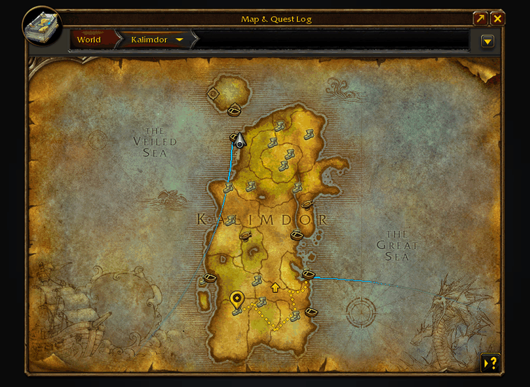
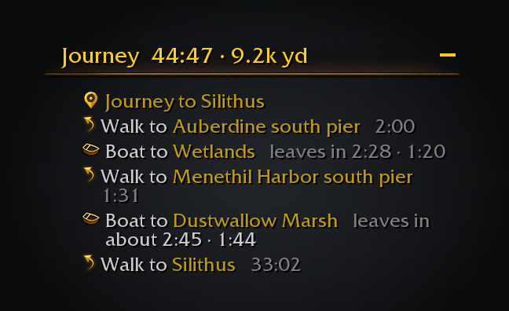
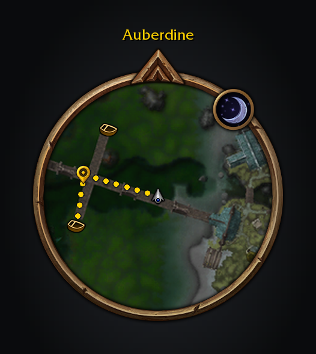
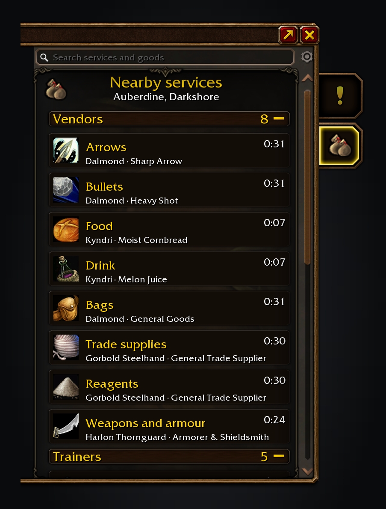
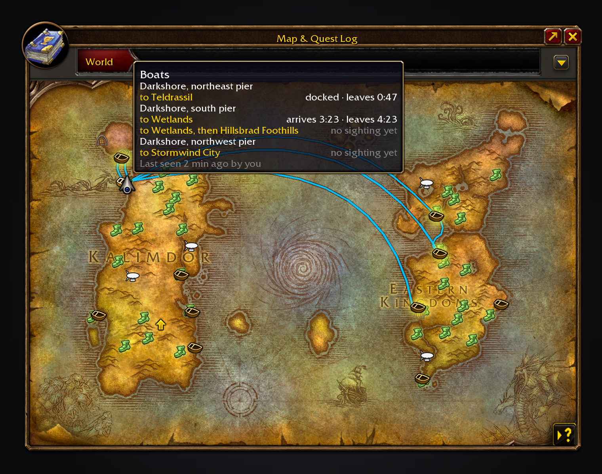

Shortest Path Forever plans a journey when you shift-click the world map or minimap, or choose a quest. It gives directions in the objective tracker and on both maps.

Everything it needs comes inside the download.

Free, with nothing locked behind it. If it saves you time, you can [sponsor me on GitHub](https://github.com/sponsors/cjber), which takes no fees, or [buy me a coffee on Ko-fi](https://ko-fi.com/cjber). For help and each day's release notes, [join me on Discord](https://discord.gg/FpHugGxRJY).

  

The route settles, the next boat counts down and the compass turns with you.

The tracker shows the trip one step at a time.

Walking breadcrumbs and the native waypoint lead to the next step.

Nearby services finds the closest vendor, trainer or inn, and how long it takes to get there.

Hover a dock to see its services and destinations.

These images are generated previews of the Shortest Path UI.

## Features

- **Plan the trip.** Combine walking, known flights, boats, zeppelins, lifts, the tram, portals and teleports. Walking routes go around walls, hills and water, and replan as you move. A spot inside a dungeon or raid leads to its entrance.
- **Find anything nearby.** The Nearby services tab in the world map's quest log lists vendors by what they sell, trainers by profession, and inns, banks, auction houses, flight masters, stables and repairs. Each shows the nearest NPC and how long it takes to get there. Search for any item to see who sells it, then click a row to go there. Arrows mark that NPC's nameplate when you arrive. Uses installed QuestieDB.
- **Follow your guide.** RestedXP and Guidelime journeys are on by default, with no TomTom or bridge addon; without TomTom, other guides' waypoints work too. Adventure Guide takes over when its RestedXP display is on.
- **Choose what you see.** Hide Journey steps or the direction arrow while keeping the map route. With OpenMap on, the route crosses its stitched map into the neighbouring zones. Move and scale the arrow, which eases round to each bearing, choose whether its label shows the distance, the time left or both, and add the time left under the compass.
- **Complete a step.** Click the current journey step and choose *Complete this step*. Skipping a Hearthstone leaves it out for that journey; other steps return if you still need them.
- **See departures.** Dock and flight master tooltips show destinations and times.
- **Travel prompts.** Hearthstone and teleport steps show what to cast. A sound and taskbar flash warn before a boat arrives, and an optional ping marks your arrival. A red corpse route guides ghosts back to their bodies.

With the gamepad interface on, you open and turn the world map; Shortest Path won't, and its right-click menus need mouse and keyboard.

## Usage

- `/path` opens settings under **Options → AddOns → Shortest Path Forever**. `/spfnear` opens the Nearby services tab.
- Alt-click the world map to choose a destination directly over a Questie icon. Shift-click the map, minimap or a Shortest Path icon; for quests, choose **Plan journey** in the right-click menu.
- In **Map marks**, scale each kind of icon. Right-click a flight master icon to mark its path known or unknown.
- In **Interface**, choose what shows, metres, sizes and a compass background. While moving the arrow or compass, Shift-drag or use the arrow keys for fine placement.
- In **Guidance**, or by right-clicking the tracker's "Journey to …" line, turn off **Attach to quest tracker** to drag the shared column. **Resume guide** returns to RestedXP or Guidelime; **Keep journeys after a reload** restarts yours.
- `/way [zone] x y [title]` plans a journey, or `/path way` when another addon owns `/way`. **Follow TomTom's arrow** in Guidance follows TomTom.
- `/path leaderboard` opens Forever Leaderboards on the Shortest Path tab, ranking completed journeys against guild and group members who report theirs, for this week or all time. The window also shows the overall standing across installed Forever addons and puts a player's place in the unit tooltip. Sharing is on unless you turn it off with the window's Share my progress box or the checkbox in **Travel journal**.

For a bug report, paste `/path report`. What it shows includes errors from earlier sessions, and `/forever debug` keeps a detailed log for the session. `/path issue` shows a filled-in GitHub issue link, selected for copying, for a bug or feature request.

Translated into German, French, Spanish, Brazilian Portuguese, Russian, Korean and Chinese (machine translated; corrections welcome through the [translation form](https://github.com/cjber/shortest-path-forever/issues/new?template=translation.yml)).

<!-- forever-family:start -->

## The Forever addons

Each one works on its own, and they work together when you install more than one.

| Addon | What it does | Issues |
|---|---|---|
| [Shortest Path Forever](https://www.curseforge.com/wow/addons/shortest-path-forever) | Plans journeys on foot, by air, by sea and through portals, with directions in the tracker. | [Issues](https://github.com/cjber/shortest-path-forever/issues) |
| [Adventure Guide Forever](https://www.curseforge.com/wow/addons/adventure-guide-forever) | Suggests quests for your level and routes you from one to the next. | [Issues](https://github.com/cjber/adventure-guide-forever/issues) |
| [SkillUp Forever](https://www.curseforge.com/wow/addons/skillup-forever) | Shows skill-up chances, recipe costs and levelling routes in the Professions window. | [Issues](https://github.com/cjber/skillup-forever/issues) |
| [Legacy Forever](https://www.curseforge.com/wow/addons/legacy-forever) | Shows your unfinished Legacy challenges on the world map and tracks the ones you choose. | [Issues](https://github.com/cjber/legacy-forever/issues) |
| [Tweaks Forever](https://www.curseforge.com/wow/addons/tweaks-forever) | Adds quest automation, rare alerts and merchant options to the game's settings. | [Issues](https://github.com/cjber/tweaks-forever/issues) |
| [Field Guide Forever](https://www.curseforge.com/wow/addons/field-guide-forever) | Keeps a cosmetic journal of the creatures you kill, zone by zone. | [Issues](https://github.com/cjber/field-guide-forever/issues) |
| [Commissions Forever](https://www.curseforge.com/wow/addons/commissions-forever) | Lists your commission turn-ins, the materials in your bags and the next NPC to visit. | [Issues](https://github.com/cjber/commissions-forever/issues) |
| [Macro Assist Forever](https://www.curseforge.com/wow/addons/macro-assist-forever) | Adds a macro window with every macro in one list, a mono editor with live checks, and history. | [Issues](https://github.com/cjber/macro-assist-forever/issues) |

Bug reports, feature requests and pull requests are welcome on each addon's GitHub. Everyone whose report or idea ships is thanked by name on the Thanks page in game, in the store page and in the changelog, unless they ask not to be.

For help, ideas and each day's release notes, join [cjber's Workshop on Discord](https://discord.gg/FpHugGxRJY).

<!-- forever-family:end -->

Installed together, the others send Shortest Path their destinations. Pick an Adventure Guide journey, one of its suggestions in a quest menu or a RestedXP or Guidelime step, or click a trainer or vendor in a SkillUp route to travel to the nearest one. Click a Legacy dungeon or raid pin, or a dungeon or raid entrance Tweaks adds to the map, to travel there. Journey steps share one tracker column with the Adventure Guide, SkillUp and Legacy sections, above your quests. If Adventure Guide or Legacy isn't installed, a grey hint suggests it where it would help; untick *Suggest my other Forever addons* on the *Forever addons* settings page to turn hints off.

<!-- forever-credits:start -->

Thanks to Alex21xx, Maggew, MacieGx, Stiandresius, The___Fast, Joster91, GenericP, Fitz, TRDeadbeat, tallsmartman, Sol_Deus, Zavian, Osipanda, Nightwind416, wfournier, cidolfus27, o0saw0o, Merlinqt, team_Brigade, phear, Testvonfarkle, rydoc, deathmvp1, saikoso, Ragnarok11B, Brainc3ll, Mouchoir, z1ck, Oxds, sean16981, aryaxo, Exo_NA, legortiz, JohnChrin, wheelbarrel00, lkshrk, HeartOfD2, rml9ty, hwalflor, chris-chrysos, Quantity-4, Bolton_wow, Aldericdevir, joaocjesus, jakerist (Grayburn), borick7318, cotijelucie, sampconrad, jixxor, Gaafah, _spada, vladsnz, macwire, scraak, overspark, TeeRKee, Speaker1264, SuubzTV, Fel7, Kragmars, spidersylar, Acem, tgkGate, IronmanBG and everyone who reported a bug or asked for a feature.

<!-- forever-credits:end -->

Source code and issues: [github.com/cjber/shortest-path-forever](https://github.com/cjber/shortest-path-forever). Licence: GPL-3.0-or-later.

Built with AI assistance.
