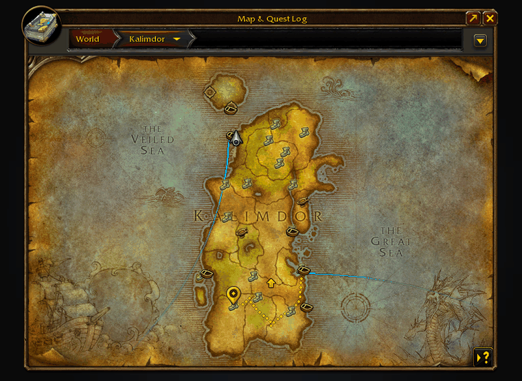
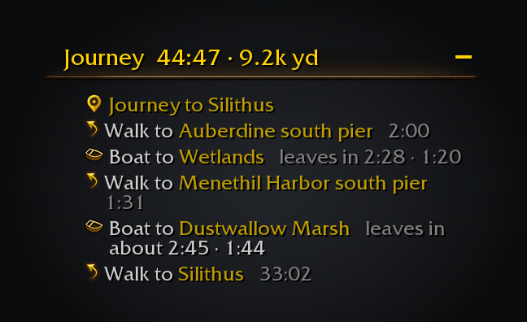
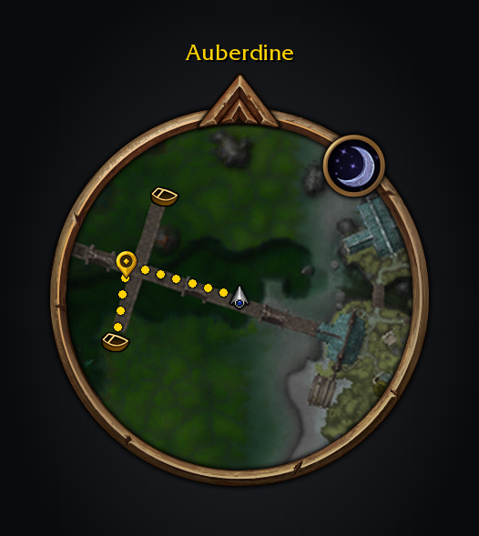
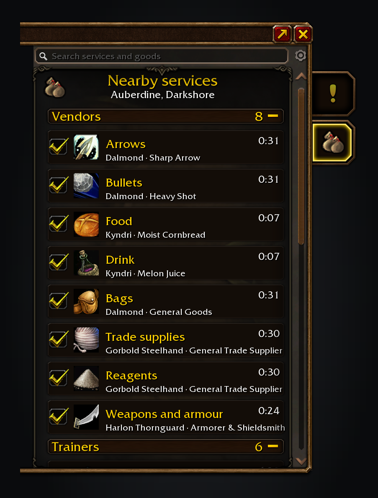
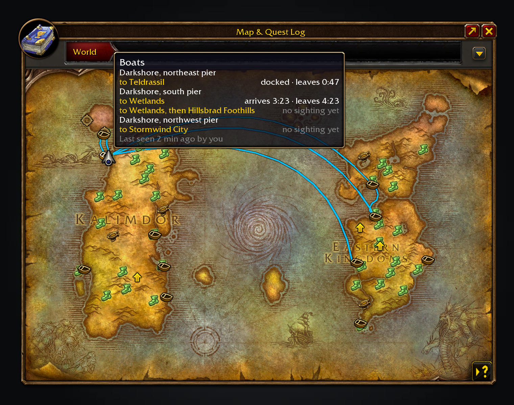

Shortest Path Forever plans journeys from a shift-click on either map or a quest you choose, then guides you on both maps and in the objective tracker.

All dependencies are included.

Free, with nothing locked behind it. If it saves you time, you can [sponsor me on GitHub](https://github.com/sponsors/cjber), which takes no fees, or [buy me a coffee on Ko-fi](https://ko-fi.com/cjber). For help and each day's release notes, [join me on Discord](https://discord.gg/FpHugGxRJY).

  

**Known limitations**

- Flight times with Frequent Flier are estimated until players confirm them.
- Walking maps are built ahead of time, so patched terrain can route wrongly until an update.
- The game names your bind point but not where it is, so the Hearthstone counts once you bind or hearth with the addon on.
- A boat, lift or tram shows "no sighting yet" until you have ridden that route once, because the game holds no timetables.
- The game gives no player height, so standing still at a lift's landing right after a ride, the tracker can name the landing you rode from until you step off it.
- The game cannot show another player's spells, so you list a party mage's portals yourself in the settings (Party mage portals).

The route settles, the boat countdown starts and the compass turns with you.

The tracker shows each step in order.

Walking breadcrumbs and the native waypoint guide each step.

Nearby services finds the closest vendor, trainer or inn, and how long it takes to get there.

Hover a dock to see its services and destinations.

These images are generated previews of the Shortest Path UI.

## Features

- **Plan the trip.** Combine walking, known flights, boats, zeppelins, lifts, the tram, portals and teleports. Walks go around walls, hills and water, and replan as you move. A spot inside a dungeon or raid leads to its entrance.
- **Find anything nearby.** The Nearby services tab (and the world map's quick button) lists vendors by what they sell, your class trainer, profession trainers, battlemasters, portal trainers for mages, inns, banks, auction houses, flight masters, stables, repairs, and dungeon and raid doors on your continent with travel times. Search and click a row to go there; arrows mark that NPC's nameplate on arrival. Right-click the map button, or use *Town services* in the map filter, to toggle each service kind on zone and city maps; click a pin to travel there. Uses installed QuestieDB.
- **Follow your guide.** RestedXP and Guidelime journeys are on by default, with no TomTom or bridge addon; without TomTom, other guides' waypoints work. Turn on *Follow Dugi guides* in Guidance to follow Dugi too. RestedXP and Dugi keep their own arrows. Adventure Guide takes over when its RestedXP display is on.
- **Choose what you see.** Hide Journey steps, the arrow, or all map marks (*Show Shortest Path marks*). With OpenMap on, the route crosses its stitched map into the neighbouring zones. Move and scale the arrow, choose whether its label shows the distance, the time left or both, and add the time left under the compass.
- **Complete a step.** Click the current journey step and choose *Complete this step*, or *Skip this stop* on a farming tour. Skipping a Hearthstone leaves it out for that journey; other steps return if you still need them.
- **See departures.** Dock and flight master tooltips show destinations and times.
- **Travel prompts.** Hearthstone and teleport steps show what to cast. A sound and taskbar flash warn before a boat arrives; an optional ping marks arrival. A red route leads ghosts to their bodies.

With the gamepad interface on, you open and turn the world map; Shortest Path won't, and its right-click menus need mouse and keyboard.

## Usage

- `/path` opens settings under **Options → AddOns → Shortest Path Forever**. `/spfnear` opens the Nearby services tab.
- Alt-click the world map to choose a destination over a Questie icon. Shift-click the map, minimap or a Shortest Path icon; for quests, choose **Plan journey** in the right-click menu. **Key to plan a journey** in **Guidance**: Shift or Alt.
- Placing the game's map pin starts a journey; **Route to your map pin** in **Guidance** turns that off, and Shift- or Alt-click still plans. **Route to the focused quest** starts journeys from a super-tracked quest or flight point too.
- In **Map marks**, scale each kind of icon, and choose whether journey stops hide the game's quest markers. Right-click a flight master icon to mark its path known or unknown.
- In **Interface**, choose what shows, metres, sizes and a compass background. While moving the arrow or compass, Shift-drag or use the arrow keys for fine placement.
- The shared Forever column sits left of the game's quest tracker. Drag a heading to move it; right-click a heading for **Lock the tracker** to stop dragging. **Resume guide** returns to RestedXP, Guidelime or Dugi Guides; your journey survives a reload.
- `/way [zone] x y [title]` plans a journey, or `/path way` when another addon owns `/way`. **Follow TomTom's arrow** in Guidance follows TomTom, and **Use TomTom's arrow** points TomTom's arrow at the current step instead of ours. With the RestedXP TomTom bridge, the bridge keeps TomTom's arrow during RestedXP guides.

For a bug report, paste `/path report`. It includes errors from earlier sessions, and `/forever debug` keeps a detailed log for the session. `/path issue` shows a filled-in GitHub issue link, selected for copying, for a bug or feature request.

Translated into German, French, Spanish, Brazilian Portuguese, Russian, Korean and Chinese (machine translated; corrections welcome through the [translation form](https://github.com/cjber/shortest-path-forever/issues/new?template=translation.yml)).

<!-- forever-family:start -->

## The Forever addons

Each one works on its own, and they work together when you install more than one.

| Addon | What it does | Issues |
|---|---|---|
| [Shortest Path Forever](https://www.curseforge.com/wow/addons/shortest-path-forever) | Plans journeys on foot, by air, by sea and through portals, with directions in the tracker. | [Issues](https://github.com/cjber/shortest-path-forever/issues) |
| [Adventure Guide Forever](https://www.curseforge.com/wow/addons/adventure-guide-forever) | Suggests quests for your level and routes you from one to the next. | [Issues](https://github.com/cjber/adventure-guide-forever/issues) |
| [SkillUp Forever](https://www.curseforge.com/wow/addons/skillup-forever) | Shows skill-up chances, recipe costs and levelling routes in the Professions window. | [Issues](https://github.com/cjber/skillup-forever/issues) |
| [Legacy Forever](https://www.curseforge.com/wow/addons/legacy-forever) | Shows your unfinished Legacy challenges on the world map and tracks the ones you choose. | [Issues](https://github.com/cjber/legacy-forever/issues) |
| [Tweaks Forever](https://www.curseforge.com/wow/addons/tweaks-forever) | Adds quest automation, rare alerts and merchant options to the game's settings. | [Issues](https://github.com/cjber/tweaks-forever/issues) |
| [Field Guide Forever](https://www.curseforge.com/wow/addons/field-guide-forever) | Keeps a cosmetic journal of the creatures you kill, zone by zone. | [Issues](https://github.com/cjber/field-guide-forever/issues) |
| [Commissions Forever](https://www.curseforge.com/wow/addons/commissions-forever) | Lists your commission turn-ins, the materials in your bags and the next NPC to visit. | [Issues](https://github.com/cjber/commissions-forever/issues) |
| [Macro Assist Forever](https://www.curseforge.com/wow/addons/macro-assist-forever) | Adds a macro window with every macro in one list, a mono editor with live checks, and history. | [Issues](https://github.com/cjber/macro-assist-forever/issues) |

Bug reports, feature requests and pull requests are welcome on each addon's GitHub. Everyone whose report or idea ships is thanked by name on the Thanks page in game, in the store page and in the changelog, unless they ask not to be.

For help, ideas and each day's release notes, join [cjber's Workshop on Discord](https://discord.gg/FpHugGxRJY).

<!-- forever-family:end -->

Installed together, the others send Shortest Path their destinations. Pick an Adventure Guide journey, one of its suggestions in a quest menu or a RestedXP, Guidelime or Dugi Guides step, or click a trainer or vendor in a SkillUp route to travel to the nearest one. Click a Legacy dungeon or raid pin, or a dungeon or raid entrance Tweaks adds to the map, to travel there. Journey steps share one tracker column with the Adventure Guide, SkillUp and Legacy sections, beside the game's quest tracker.

Capital trails come from Fitz's [Polestar](https://github.com/fitzforge/polestar), used with permission.

<!-- forever-credits:start -->

Thanks to xh43k, Alex21xx, Maggew, alexaroth, MacieGx, cmartin303, kaelr1, Stiandresius, Zhiroc, lukehmu, static2290, forleong, Chulf58, user_lsqt69ps7bgb5p7e, jakerist, The___Fast, Joster91, GenericP, HeartOfD2, rml9ty, hwalflor, borick7318, cotijelucie, _spada, vladsnz, Bervath, user_sggieekz05hc7uxt, kindguydev, ubrider, Drusangus, PrinceOfPromise, jaidy_, hailtohell, Nedula, icouldonlygetthisname, user_u3k9hweaatfhnjs0, treadpool, user_g496wu46adiwjuc5, emmiehbun, VolomonBeddarm, zhega, catubba, Hatemost, JaidyEU, embiem, InfamousMunky, user_6q0jf3zanigk317s, Enel3008, azure463, AsimRamay, nookie909, Zerhathos, cobalt_44, Xeteskian, DaFrozenMage, user_zbqhuuoypkkr46x1, Fitz, TRDeadbeat, tallsmartman, Sol_Deus, Zavian, Osipanda, Nightwind416, wfournier, cidolfus27, o0saw0o, Merlinqt, team_Brigade, phear, Testvonfarkle, rydoc, deathmvp1, saikoso, Ragnarok11B, Brainc3ll, Mouchoir, z1ck, Oxds, sean16981, aryaxo, Exo_NA, legortiz, JohnChrin, wheelbarrel00, lkshrk, chris-chrysos, Quantity-4, Bolton_wow, Aldericdevir, joaocjesus, sampconrad, jixxor, Gaafah, macwire, scraak, overspark, TeeRKee, Speaker1264, SuubzTV, Fel7, kragmars, spidersylar, Acem, tgkGate, user_efwsfml273dlvfm5, IronmanBG, vcatalin, sdtom, Blast22, hervad, caghanpekin-prog, Zwaffelmagic, CptShooter, user_10oietw0rdrgk4le, cwebbx, lone_viking1921, Nivlemoth_Nathrezim, Lůca [Luutsa], esc_return, MrOxiMoron, Crypa7, ghuff07, nimri82, Hex_512, klessky92_, user_nj1mf9vmj5vyv6iu, ScottWilson0903, mrhumid, user_0dz6gz97l7u8znua12954, Gieryic, row023, FalconDS9, karrier_user_slouyac50poxg707, Marlynnie, vibblez, dumbdavid, user_8hw6almdkhj2amgo, user_pznv13y5espypdlg, Pharadigm, smsunarto, itsthatguy, KariArisu, user_391rfqgumztl83m4, Banantwist, znke, Freaky_Fred1, user_qtzuiuer28ngqgnt, syrieal, user_mtserwgidj8lchpp, .r.c.j, user_lcyuz0oeo02at06036285, TT_El_Barto, AdrianOrenstein, antarek, user_lfc6afjgqiurfo3964026, lumpi_lumpi, JanitorHead, bradeckz, EPSH, therealdoctordave, TechnoHunter, konasek20, farbod21, thefarbod, SelkieMoejun, aoulacg23211, geno1, wesslan, JRBVoodoo, user_tr1cy1rhqvkqen5u63977, Rayve0Black, Wraith12, puglife_636, markits, user_h1s2g8ruvulbm6909075, Crazy_Yew_Trees, schmelbertina and everyone who reported a bug or asked for a feature.

<!-- forever-credits:end -->

Source code and issues: [github.com/cjber/shortest-path-forever](https://github.com/cjber/shortest-path-forever). Licence: GPL-3.0-or-later.

Built with AI assistance.
